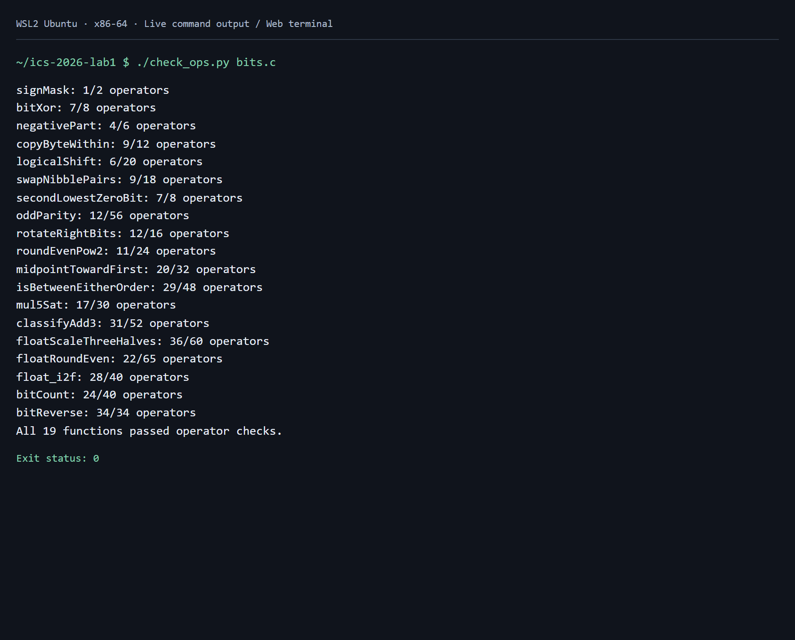
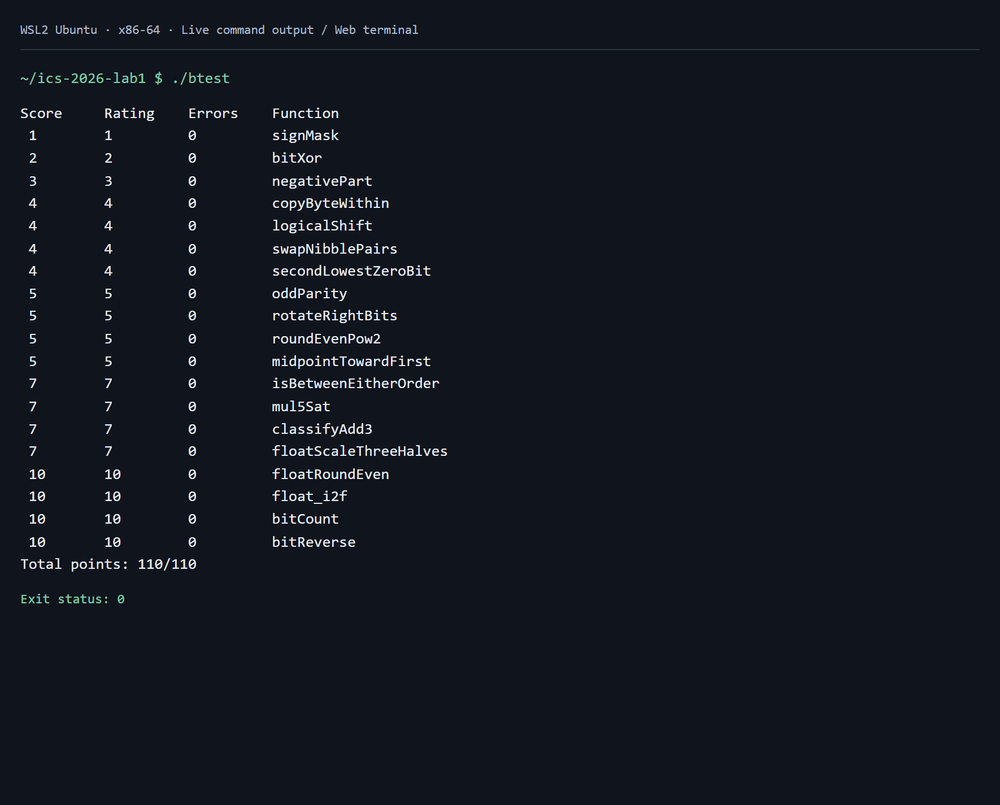

# Lab1：DataLab 实验报告

姓名：温祺荣  
学号：23307110254

## 实验环境与验证

实验在 Windows 的 WSL2 Ubuntu x86-64 环境中完成，使用 GCC 按课程 Makefile 的 `-O -Wall -fwrapv -m32` 选项编译。整数题按课程规定的 32 位补码位向量模型实现；浮点题仅对整数编码进行操作。

修改范围为 `bits.c` 的姓名信息和 P1–P19 函数体，未修改函数签名、测试程序、规则检查器或 `.github` 评分配置。

执行流程：

```bash
make clean
make all
./check_ops.py bits.c
./btest
./test.sh
```

规则检查的 19 个函数全部通过，正确性测试中各题 `Errors` 均为 0，总分为 `110/110`，一键流程返回状态码 0。以下图片是在本地网页终端中实际执行 WSL 命令后截取的输出截图，未修改测试输出；原始文本同时保存在 `assets/` 中，便于核对。





## 各函数实现思路

### P1 signMask

将整数 1 左移 31 位，只留下最高位，得到 `0x80000000`。

### P2 bitXor

异或表示两个位不同。用德摩根律把“至少有一个为 1”写成 `~(~x & ~y)`，再与 `~(x & y)` 相与，排除两个位同时为 1 的情况，全程只用 `~` 与 `&`。

### P3 negativePart

算术右移 `x >> 31`，负数得到全 1 掩码，非负数得到全 0 掩码。将该掩码与补码取负 `~x + 1` 相与即可。`INT_MIN` 的取负按题目位向量模型保留低 32 位。

### P4 copyByteWithin

将字节编号左移 3 位得到位偏移。先右移并用 255 提取源字节，再清空目标字节，最后把源字节左移到目标位置并合并。源、目标相同也能保持原值。

### P5 logicalShift

先执行算术右移，再清除高位的符号扩展。由最高位构造掩码 `~(((1 << 31) >> n) << 1)`，保留低 `32-n` 位。`n=0` 时掩码为全 1，避免右移或左移 32 位。

### P6 swapNibblePairs

构造 `0x0f0f0f0f`，提取每个字节的低半字节后左移 4 位；右移后的高半字节再用同一掩码提取。两部分按位或，实现每个字节内部的交换。

### P7 secondLowestZeroBit

先对 `x` 取反，使原来的 0 位成为 1 位。`v & (v-1)` 清除最低的 1 位，再用 `v & -v` 提取剩余最低的 1 位，即原数第二低的 0 位。减一和取负分别用 `+ ~0`、`~v + 1` 实现。不足两个 0 位时结果自然为 0。

### P8 oddParity

依次与右移 16、8、4、2、1 位的自身异或，把所有位的奇偶性折叠到最低位。最低位为 1 表示原数有奇数个 1，对它取逻辑非，得到题目要求的奇校验补位。

### P9 rotateRightBits

用 `n & 31` 计算实际右移位数，左移位数用 `(~shift + 1) & 31` 得到。右移部分通过掩码去掉符号扩展，再与左移部分合并。两种位移量均落在 0–31 内，32 的倍数也能正确处理。

### P10 roundEvenPow2

设半程为 `2^(n-1)`，商的最低位为 `(x >> n) & 1`。给 `x` 加上“半程减一加商的奇偶位”，再右移、左移 `n` 位清除余数。小于半程时不进位，大于半程时进位；正好半程时仅奇数商进位，因此选择偶数商。

### P11 midpointTowardFirst

利用 `(x & y) + ((x ^ y) >> 1)` 计算向下取整的中点，避免直接求 `x+y` 的溢出。当两数奇偶性不同且 `x>y` 时，中点应向较大的第一参数靠近，因此补 1。比较时分别处理异号与同号输入，避免用可能溢出的减法直接比较异号数。

### P12 isBetweenEitherOrder

分别计算 `x<a` 与 `x<b`。异号时由 `x` 的符号判断，同号时由差的符号判断。严格比较结果不同表示 `x` 位于两端点之间；再单独加入等于任一端点的情况，得到含端点区间，不需要预先交换 `a` 与 `b`。

### P13 mul5Sat

用加法依次得到 `2x`、`4x`、`5x`。若任一步相对于原数改变符号，就说明数学意义的 `5x` 已超出有符号整数范围。将这些符号差异合并成溢出掩码，按原数符号选择 `INT_MAX` 或 `INT_MIN`，否则保留 `5x`。

### P14 classifyAdd3

先计算两次加法的低 32 位。无符号加法的最高位进位可由 `(a & b) | ((a | b) & ~sum)` 的最高位得到。将三个输入的符号扩展与两次进位相加，得到精确和的高位部分；再减去低 32 位结果应有的符号扩展。差为 0 表示可表示，正差表示超过 `INT_MAX`，负差表示小于 `INT_MIN`，最终映射到 0、1、-1。这个方法能处理第一次加法溢出、随后被第三个数抵消的情况。

### P15 floatScaleThreeHalves

拆分符号、阶码和尾数，规格化数补上隐藏的最高有效位。将有效数乘 3，再根据所需阶码右移 1 或 2 位，实现乘 `3/2`。保留被丢弃的位：余数超过半程则进位，等于半程时仅在保留部分为奇数时进位。之后处理尾数进位、非规格化到规格化的边界和溢出到无穷。NaN、无穷保持原编码，正负零保持符号。

### P16 floatRoundEven

按阶码分情况。绝对值小于 0.5 返回保留符号的零；恰好 0.5 舍到偶数零，0.5 到 1 之间舍到 1。有效指数达到 23 时已没有小数部分，直接返回，NaN 与无穷也由该分支保留。其余情况用掩码分离小数位，比较余数与半程，并在中点检查整数最低位的奇偶性；清除小数位后按需加一个整数单位。

### P17 float_i2f

先记录符号，在 `unsigned` 中构造绝对值，保证 `INT_MIN` 也能处理。通过右移确定最高有效位位置，得到阶码。有效位不超过 24 位时左移即可精确表示；否则提取前 24 位，根据丢弃部分执行最近偶数舍入。最后用加法拼接阶码与去掉隐藏位的尾数，尾数舍入进位时可以自然增加阶码。

### P18 bitCount

构造按 1、2、4 位分组的掩码，先统计每两位的 1，再合并到每四位、每八位。最后通过右移 8 位和 16 位相加，把各字节计数累加到最低字节，取低 6 位即可表示 0–32。

### P19 bitReverse

依次交换相邻 1 位、2 位、4 位、8 位分组，最后交换两个 16 位半字。由 `0x0000ffff` 逐级异或其左移值，得到 `0x00ff00ff`、`0x0f0f0f0f`、`0x33333333`、`0x55555555`，减少掩码构造的操作数。右移部分均用掩码清除符号扩展，整个实现为 34 次操作，符合上限。

## 参考资料与辅助工具

- [课程 Lab1 实验说明](https://ics-26fall-fdu.github.io/labs/lab1-data-lab/)。
- [课程 DataLab 模板仓库](https://github.com/ICS-26Fall-FDU/DataLab)中的 `README.md`、`bits.c` 题目说明及官方测试工具。
- 使用 OpenAI Codex 辅助推导与生成函数实现、执行检查、整理报告。验证结果来自实际运行的课程工具；本报告如实披露 AI 辅助，没有把该过程描述为独立完成。
